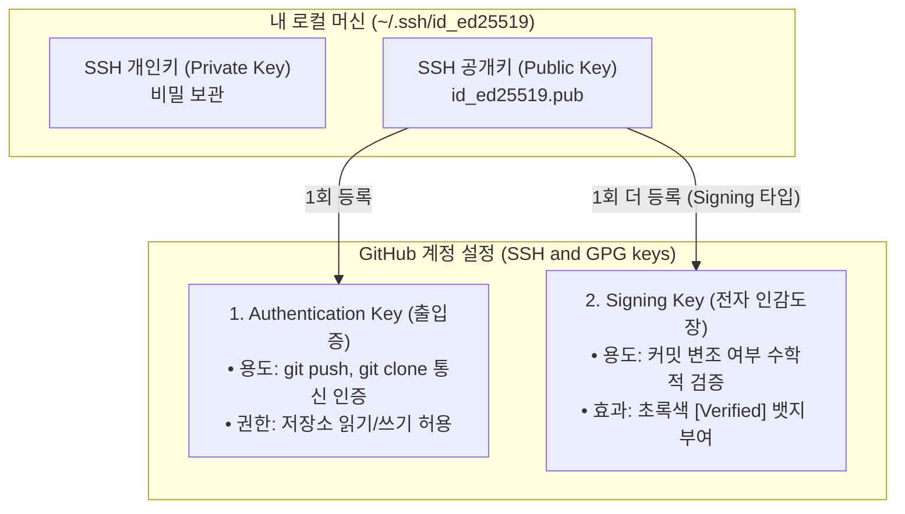

Git 환경에서 커밋을 할 때 이메일만 조작하면 누구나 타인 명의로 커밋을 작성할 수 있다는 사실을 알고 계셨나요? 

이 가이드에서는 별도의 무거운 GPG 도구 설치 없이, **초경량 고성능 타원곡선 암호화(Ed25519) SSH 키 하나로 GitHub 통신 인증(Authentication)과 커밋 위조를 원천 차단하는 전자서명(Signing) 체계를 구축하는 방법**을 단계별로 정리합니다.

---

## 1. Authentication Key vs Signing Key 개념 이해

GitHub에서는 동일한 SSH 키에 대해 **"용도(Key Type)"**를 엄격히 분리하여 취급합니다:



| 구분 | 목적 | 역할 | 비유 |
| :--- | :--- | :--- | :--- |
| **Authentication Key** | 통신 및 접근 제어 | `git clone`, `git push` 시 내 계정임을 인증 | 건물의 **출입증 (ID 카드)** |
| **Signing Key** | 무결성 및 위조 방지 | 커밋에 암호학적 전자서명을 찍어 작성자를 증명 | 계약서의 **전자 인감도장** |

---

## 2. 1단계: 초경량 고보안 Ed25519 SSH 키 생성

RSA(2048/4096비트) 대신 현대 암호학의 표준인 **Ed25519(타원곡선 전자서명 알고리즘)**을 사용합니다. 키 길이가 짧고 성능이 압도적이며 보안성이 뛰어납니다.

터미널에서 아래 명령을 실행합니다:

```bash
ssh-keygen -t ed25519 -C "your_email@example.com"
```

1. 저장 위치는 기본값(`~/.ssh/id_ed25519`)에서 Enter를 누릅니다.
2. 암호(Passphrase)를 입력하거나 공란으로 Enter를 칩니다.
3. 생성이 완료되면 `~/.ssh/` 하위에 2개의 파일이 생성됩니다:
   * `id_ed25519`: **개인키 (Private Key)** - 절대 외부에 노출 금지 (권한 `600`)
   * `id_ed25519.pub`: **공개키 (Public Key)** - GitHub에 등록할 검증용 자물쇠

---

## 3. 2단계: macOS SSH Agent 및 키체인 연동

터미널을 열 때마다 매번 SSH 키를 다시 묻지 않도록 macOS 키체인에 등록합니다.

`~/.ssh/config` 파일을 생성하거나 수정합니다:

```bash
cat << 'EOF' >> ~/.ssh/config

Host github.com
    HostName github.com
    User git
    IdentityFile ~/.ssh/id_ed25519
    AddKeysToAgent yes
    UseKeychain yes
EOF

chmod 600 ~/.ssh/config
```

SSH 에이전트에 키를 추가합니다:
```bash
ssh-add --apple-use-keychain ~/.ssh/id_ed25519
```

---

## 4. 3단계: GitHub 웹에 두 가지 키 타입으로 등록

공개키 내용을 복사합니다:
```bash
cat ~/.ssh/id_ed25519.pub
# 출력 예시: ssh-ed25519 AAAAC3NzaC1lZDI1NTE5... your_email@example.com
```

브라우저에서 **[GitHub ➡️ Settings ➡️ SSH and GPG keys](https://github.com/settings/keys)**로 이동합니다.

### ① 첫 번째: Authentication Key 등록 (통신용)
1. **[New SSH key]** 버튼 클릭
2. **Title**: `MacBook Pro (Auth)`
3. **Key type**: **`Authentication Key`** 선택 (기본값)
4. **Key**: 복사한 공개키 붙여넣기 ➡️ **[Add SSH key]**

### ② 두 번째: Signing Key 등록 (서명용)
1. 다시 한번 **[New SSH key]** 버튼 클릭
2. **Title**: `MacBook Pro (Signing)`
3. **Key type**: 드롭다운에서 반드시 **`Signing Key`** 선택!
4. **Key**: 동일한 공개키 붙여넣기 ➡️ **[Add SSH key]**

> 등록을 마치면 SSH 목록에 **[Authentication Key]**와 **[Signing Key]** 뱃지가 나란히 표시됩니다.

---

## 5. 4단계: 로컬 Git 2.34+ 내장 SSH 서명 스위치 켜기

무거운 GPG 도구를 설치할 필요 없이, **Git 자체 내장 SSH 서명 기능**을 활성화합니다.

전역 Git 설정에 3줄을 추가합니다:

```bash
# 1. 서명 포맷을 SSH로 지정
git config --global gpg.format ssh

# 2. 서명에 사용할 공개키 지정
git config --global user.signingkey ~/.ssh/id_ed25519.pub

# 3. 모든 커밋에 자동 서명 강제 적용
git config --global commit.gpgsign true
```

설정 후 `~/.gitconfig`는 아래와 같은 형태가 됩니다:

```ini
[user]
	name = YourName
	email = your_email@users.noreply.github.com
	signingkey = ~/.ssh/id_ed25519.pub
[commit]
	gpgsign = true
[gpg]
	format = ssh
```

---

## 6. 5단계: 로컬 서명 검증 파일(`allowed_signers`) 구성

Git이 로컬 터미널에서 `git log --show-signature`를 실행할 때 "이 서명이 내가 신뢰하는 키가 맞는지" 검증할 수 있도록 허용 목록 파일(`allowed_signers`)을 구성합니다.

```bash
# 1. allowed_signers 파일 생성 (이메일, 네임스페이스, 공개키 조합)
echo "$(git config user.email) namespaces=\"git\" $(cat ~/.ssh/id_ed25519.pub)" > ~/.ssh/allowed_signers
chmod 644 ~/.ssh/allowed_signers

# 2. Git에 allowed_signers 파일 위치 등록
git config --global gpg.ssh.allowedSignersFile ~/.ssh/allowed_signers
```

---

## 7. 6단계: 실증 테스트 및 `Verified` 뱃지 확인

모든 설정이 완료되었습니다. 테스트 커밋을 생성하고 서명이 작동하는지 검증합니다:

```bash
# 1. 테스트 커밋 생성 (자동 서명 적용)
git commit -m "test: verify ssh commit signature"

# 2. 로컬에서 암호학적 서명 유효성 검증
git log -1 --show-signature
```

성공 시 아래와 같이 초록색 검증 성공 메시지가 출력됩니다:
```text
commit 101d1cb... (HEAD -> main)
Good "git" signature for your_email@users.noreply.github.com with ED25519 key SHA256:...
Author: YourName <your_email@users.noreply.github.com>
```

이제 `git push`를 실행하면, GitHub 웹 인터페이스의 커밋 목록에 자랑스러운 초록색 **`Verified`** 뱃지가 달린 것을 확인할 수 있습니다!

---

## 8. 트러블슈팅 가이드

### Q1. `error: gpg.ssh.allowedSignersFile needs to be configured` 오류
* **원인**: 로컬에서 서명을 검증할 공개키 목록 파일이 없어서 발생합니다.
* **해결**: 본 가이드의 **6단계**에 따라 `~/.ssh/allowed_signers`를 만들고 `git config --global gpg.ssh.allowedSignersFile ~/.ssh/allowed_signers`를 등록하면 해결됩니다.

### Q2. GitHub에서 여전히 `Unverified`로 뜨는 경우
* **원인 1**: GitHub 웹에 등록할 때 Key type을 `Signing Key`가 아닌 `Authentication Key`로 등록한 경우.
* **원인 2**: Git의 커밋 이메일(`git config user.email`)과 GitHub 계정에 등록된 이메일 주소가 서로 다른 경우.
* **해결**: GitHub 웹에서 `Signing Key` 타입으로 재등록하고, 커밋 이메일이 GitHub 프로필 이메일(또는 공식 No-reply 이메일)과 일치하는지 확인합니다.
