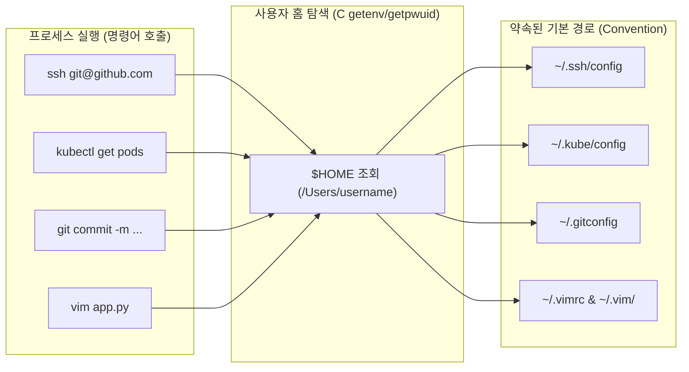
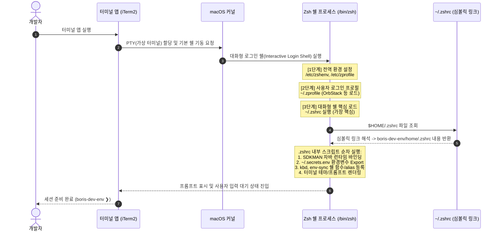

개발 환경을 구성하다 보면 홈 디렉터리(`~/`) 하위에 `.zshrc`, `.gitconfig`, `.ssh`, `.kube` 등 수많은 점(`.`)으로 시작하는 파일과 폴더들을 마주하게 됩니다. 

이 문서에서는 **맥북(macOS)과 UNIX 시스템이 이 도트파일들을 인식하는 내부 메커니즘**과 **터미널을 열었을 때 `.zshrc`가 실행되어 환경을 완성하는 부팅 라이프사이클**을 심층 분석합니다.

---

## 1. Dotfile(`.`)의 기원과 시스템 인식 원리

결론부터 말하면, **macOS 운영체제 자체에 도트파일을 자동으로 감지하고 등록하는 중앙 엔진이 존재하는 것이 아닙니다.**  
이는 **"UNIX의 숨김 파일 관례(Convention)"**와 **"각 도구들이 약속된 경로를 탐색하는 소프트웨어 아키텍처"**의 결과물입니다.

### ① 이름 앞에 점(`.`)이 붙은 역사적 기원
* 1970년대 초 벨 연구소에서 UNIX를 개발하던 켄 톰슨(Ken Thompson)과 데니스 리치(Dennis Ritchie)가 디렉터리 탐색 명령어(`ls`)를 작성할 때, 현재 디렉터리(`.`)와 상위 디렉터리(`..`)를 화면 출력에서 제외하기 위해 아래와 같은 단순한 조건문을 추가했습니다:
  ```c
  if (name[0] == '.') continue;
  ```
* 이 단순한 구현에서 의도치 않은 규칙이 탄생했습니다. 첫 글자가 `.`인 모든 파일이 목록에서 보이지 않게 된 것입니다.
* 이후 개발자들이 평소 작업 영역을 어지럽히지 않으면서 설정을 보관하기 위해 `~/.profile`, `~/.exrc` 등 설정 파일 이름 앞에 점을 붙이기 시작했고, 이것이 50년이 지난 오늘날까지 모든 유닉스/POSIX 계열 운영체제의 **"숨김 파일(Hidden Files) 표준 관례"**로 정착되었습니다.
* macOS의 Finder나 터미널의 `ls`는 파일 시스템(APFS)에서 메타데이터를 읽어올 때 첫 글자가 `.`이면 단순히 **사용자 인터페이스(UI) 상에서 렌더링을 생략**합니다.

### ② 왜 시스템 전역(`/etc`)이 아니라 사용자 홈(`~/`)에 모아둘까?
macOS는 다중 사용자(Multi-User)를 기본 지원하는 UNIX(BSD) 기반 시스템입니다.
* **시스템 전역 공통 설정**: `/etc/` (루트 관리자 권한 필요, 모든 사용자 공통)
* **개인화된 작업 환경**: `/Users/<username>/` (사용자 권한, 계정 간 철저한 격리)

따라서 내가 커밋할 때 사용할 Git 닉네임, 나만의 SSH 키페어, Zsh 프롬프트 테마는 **다른 사용자나 시스템 코어에 영향을 주지 않도록 반드시 내 홈 디렉터리(`~/.xxx`)에 위치**해야 합니다.

---

## 2. 프로세스별 "약속된 탐색 경로(Convention)" 실체

프로그램을 실행했을 때 맥북이 알아서 설정을 꽂아주는 것이 아니라, **실행된 각 프로세스가 직접 사용자의 홈 디렉터리를 찾아가 약속된 파일을 Open**합니다.



### 주요 프로세스별 기본 탐색 경로 명세

| 실행 명령어 | 프로세스 | 약속된 기본 탐색 경로 | 프로세스 내부 동작 실체 |
| :--- | :--- | :--- | :--- |
| **`ssh`** | OpenSSH Client | `~/.ssh/config`<br/>`~/.ssh/id_*` | OpenSSH 소스코드에 `#define _PATH_SSH_USER_CONFFILE ".ssh/config"`가 정의되어 있어, 접속 시 가장 먼저 이 파일의 Host 규칙과 개인키를 조회합니다. |
| **`kubectl`** | Kubernetes CLI | `~/.kube/config` | Kubernetes 클라이언트(Go 언어) 소스코드 내 `clientcmd.RecommendedHomeFile`에 `$HOME/.kube/config`가 하드코딩되어 클러스터 엔드포인트와 토큰을 로드합니다. |
| **`git`** | Git Core | `~/.gitconfig` | 저장소 단위 설정(`.git/config`)을 읽기 전, 글로벌 사용자 프로필(`user.name`, `user.email`)을 가져오기 위해 `$HOME/.gitconfig`를 읽습니다. |
| **`vim` / `nvim`** | Vi IMproved | `~/.vimrc`<br/>`~/.vim/` | 에디터 시작 시 플러그인, 키 매핑, 폰트 설정을 메모리에 올리기 위해 가장 먼저 스캔합니다. |
| **`docker`** | Docker CLI | `~/.docker/config.json` | 도커 레지스트리(Docker Hub, ECR) 인증 크레덴셜 및 CLI 플러그인 설정을 조회합니다. |

### 기본 탐색 경로 오버라이드 (Override)
도구들은 이러한 관례적 기본 경로를 제공하는 동시에, 특정 상황에서 다른 설정을 참조할 수 있도록 **환경변수 또는 CLI 플래그를 통한 오버라이드 탈출구**를 지원합니다:

```bash
# 기본: ~/.kube/config 읽기
kubectl get pods

# 오버라이드: 별도의 kubeconfig 파일 강제 지정
KUBECONFIG=/tmp/dev-cluster.yaml kubectl get pods
```

```bash
# 기본: ~/.ssh/config 읽기
ssh user@server

# 오버라이드: 커스텀 SSH 설정 파일 지정
ssh -F /path/to/custom_ssh_config user@server
```

---

## 3. 터미널 기동 시 `.zshrc` 부팅 라이프사이클

터미널 앱(iTerm2, macOS Terminal)을 실행하는 순간, Zsh 쉘 프로세스는 정해진 순서에 따라 설정 스크립트를 단계별로 실행(`source`)합니다.



### Zsh 초기화 파일 실행 순서

1. **/etc/zshenv ➡️ ~/.zshenv**
   * 모든 Zsh 쉘(스크립트 실행 포함)이 기동될 때 가장 먼저 읽습니다.
   * 패스(`$PATH`) 기본값을 정할 때 사용됩니다.
2. **/etc/zprofile ➡️ ~/.zprofile**
   * 터미널에 새로 로그인할 때(Login Shell) 딱 1회 실행됩니다.
   * OrbStack 통합이나 Homebrew 환경변수 초기화가 주로 여기에 들어갑니다.
3. **/etc/zshrc ➡️ `~/.zshrc` (★ 가장 중요)**
   * **사용자와 키보드로 상호작용하는 대화형 쉘(Interactive Shell)**이 열릴 때마다 실행됩니다.
   * `rc`는 1960년대 초창기 운영체제(CTSS)의 **"Run Commands(명령어 실행)"**에서 유래했습니다.
   * 터미널 단축키(alias), 프롬프트 테마, `kbd` / `env-sync` 같은 쉘 커스텀 함수들이 이 단계에서 메모리에 등록됩니다.
4. **/etc/zlogin ➡️ ~/.zlogin**
   * 로그인이 성공적으로 완료된 후 최종 환영 메시지(MOTD)를 출력할 때 쓰입니다.
5. **~/.zlogout**
   * 터미널 세션을 종료(`exit`)할 때 정리 작업을 위해 호출됩니다.

---

## 4. 엔지니어링 아키텍처 관점의 시사점

1. **심볼릭 링크의 투명성 (VFS Symlink)**:
   * `~/.zshrc`가 `~/workspace/boris-dev-env/home/.zshrc`를 가리키는 심볼릭 링크일 때, Zsh 프로세스는 링크 여부를 의식하지 않고 평범하게 파일을 읽습니다. macOS 커널이 파일 시스템 레이어에서 자동으로 실체 파일의 inode로 연결해 주기 때문입니다.
2. **단일 진실 공급원(SSOT)과 Dotfiles 관리**:
   * 각 도구들의 "약속된 홈 경로(`~/.xxx`)"를 그대로 유지하면서도, 실체 파일은 버전 관리 저장소(`boris-dev-env`)에 보관하고 심볼릭 링크로 연결하는 구조가 현대 엔지니어링의 표준 도트파일 관리 패턴입니다.
3. **환경변수의 동적 주입**:
   * `~/.zshrc` 기동 시점에 로컬 격리된 `~/.secrets.env`를 동적으로 `source`함으로써, 민감한 키값은 버전 관리(Git)에 올리지 않으면서도 터미널 프로세스 메모리에만 안전하게 환경변수를 공급할 수 있습니다.
