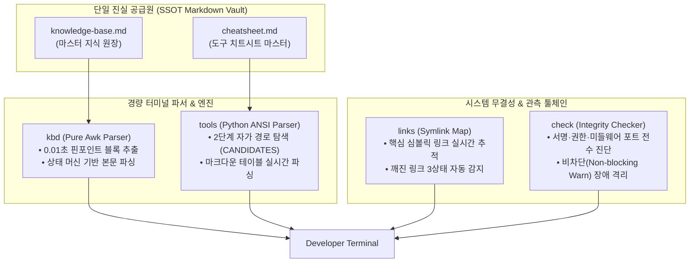

# 단일 진실 공급원(SSOT)의 터미널 시각화: 마크다운 실시간 파서와 1초 무결성 건강 검진 툴체인 구축기

엔지니어링 환경이 복잡해질수록 개발자는 수많은 CLI 명령어, 쉘 단축키(alias), 인프라 포트, 환경변수 관리 규격을 마주하게 됩니다.

이때 거의 모든 개발팀과 엔지니어가 겪는 고질적인 병폐가 바로 **'문서(Documentation)와 실행(Execution)의 이원화(Dual-Management)'**입니다:
* 새로운 CLI 유틸리티나 유용한 단축키를 만들었지만, 위키나 마크다운 문서 갱신을 깜빡하여 혼자만의 도구로 남거나 망각됩니다.
* 반대로 노션이나 옵시디언에 정성스레 치트시트를 정리해 두었지만, 터미널 작업 도중 브라우저를 띄워 검색하는 과정이 번거로워 결국 쓰지 않게 됩니다.
* 수십 개의 도트파일(Dotfiles)을 심볼릭 링크로 연결해 두었지만, 어느 날 원본 경로가 바뀌어 **'깨진 심볼릭 링크(Dangling/Broken Symlink)'**가 되었음에도 실제 런타임 오류가 터지기 전까지 눈치채지 못합니다.

우리는 이 문제를 해결하기 위해 별도의 무거운 외부 패키지나 상용 데몬 없이, **마크다운 문서 자체를 단일 진실 공급원(Single Source of Truth, SSOT)으로 삼아 0.01초 만에 터미널 CLI로 동적 파싱·시각화하고, 시스템 전반의 무결성을 1초 만에 건강 검진하는 경량 툴체인(`tools`, `kbd`, `links`, `check`)**을 구축했습니다.

본 문서에서는 개발 환경의 지식 파편화를 종식시키고 시스템 관측 가능성(Observability)을 확보한 4가지 핵심 도구의 설계 아키텍처와 구현 노하우를 공유합니다.

---

## 1. 아키텍처 목표 및 설계 철학

시스템을 관통하는 3대 엔지니어링 철학은 다음과 같습니다:

1. **빌드 없는 즉시 동기화 (Zero-Compilation & Zero-Latency)**:
   * 마크다운 파일에 새로운 도구 행을 한 줄 추가하거나 설명을 수정하는 즉시, 터미널 CLI 도구(`tools`, `kbd`)가 실시간(On-the-fly) 파싱하여 0초 만에 반영합니다. 컴파일이나 바이너리 재빌드 과정이 전혀 없습니다.
2. **외부 의존성 제로 (Zero External Dependency)**:
   * 별도의 패키지 매니저(`npm`, `pip`, `cargo`)로 무거운 프레임워크를 설치하지 않고, 모든 유닉스/리눅스 표준 툴체인인 **POSIX `bash`, `awk`, 그리고 시스템 기본 `python3` 표준 라이브러리(`re`, `os`, `sys`)**만으로 동작합니다.
3. **완전한 시스템 관측 가능성 (Complete System Observability)**:
   * 심볼릭 링크의 정상 연결 여부부터 파일 권한(`chmod 600`), 전자서명 키페어, 컨테이너 미들웨어 포트, 런타임 버전까지 시스템의 종합 건강 상태를 단 1초 만에 실측 검증합니다.

---

## 2. 아키텍처 의사결정: 바이너리 컴파일 vs 실시간 마크다운 파싱

많은 엔지니어가 CLI 도구를 제작할 때 Rust(Clap), Go(Cobra), Node.js(Commander) 등으로 바이너리를 컴파일하거나 패키징하는 방식을 먼저 떠올립니다. 하지만 우리는 **'표준 Python3 정규식과 Awk 기반의 실시간 파싱(On-the-fly Parsing)'**을 선택했습니다.

| 비교 항목 | 컴파일 기반 CLI (Rust / Go) | 실시간 마크다운 파서 (Python3 / Awk) | 채택 이유 |
| :--- | :--- | :--- | :--- |
| **반영 속도** | 코드 수정 ➔ 컴파일 ➔ 바이너리 교체 필요 | **마크다운 파일 저장 즉시 0초 반영** | 문서 수정 즉시 터미널 렌더링에 동기화 |
| **단일 진실 공급원** | 코드(CLI)와 문서(Markdown)의 이원화 발생 | **마크다운 문서 1벌이 곧 CLI 데이터 소스** | 문서 관리 오버헤드 0% 실현 |
| **외부 의존성** | 언어별 툴체인 및 빌드 도구 필요 | **OS 내장 기본 런타임만 사용 (Zero-Dep)** | 새 머신에서 별도 설치 없이 즉시 실행 |
| **실행 속도** | ~0.005초 | **~0.01초 (체감 지연 0)** | 사람이 인지할 수 없는 초고속 응답 |

문서와 CLI의 괴리를 원천 차단하기 위해서는 **"문서 그 자체가 실행 런타임의 입력 소스"**가 되어야 한다는 원칙이 기술 선택의 핵심 기준이었습니다.

---

## 3. 전체 시스템 토폴로지 및 파이프라인

중앙 저장소(`~/.dotfiles`)의 지식 문서와 런타임 인프라는 아래와 같이 유기적으로 연결되어 터미널 CLI로 표출됩니다.



---

## 4. 핵심 도구 심층 분석 및 구현 디테일

### 4.1 `tools`: 마크다운 실시간 파서 기반 동적 CLI 뷰어

`tools`는 중앙 마크다운 문서(`cheatsheet.md`)를 실시간으로 파싱하여 터미널에 ANSI 컬러가 적용된 표와 목록으로 출력하는 Python CLI 도구입니다.

#### 1) 2단계 자가 경로 탐색 (Self-Resolving Fallback)
스크립트가 심볼릭 링크(`~/.local/bin/tools`)를 통해 실행되든, 레포지토리 내부에서 직접 실행되든 마스터 마크다운 문서를 잃어버리지 않도록 2단계 탐색 폴백 메커니즘을 내장하고 있습니다.

```python
# tools: 마스터 마크다운 문서 2단계 자가 경로 해석
CANDIDATES = [
    os.path.expanduser('~/.dotfiles/docs/cheatsheet.md'),
    os.path.join(os.path.dirname(os.path.abspath(__file__)), '../docs/cheatsheet.md')
]

CHEATSHEET_PATH = None
for p in CANDIDATES:
    if os.path.isfile(p):
        CHEATSHEET_PATH = os.path.abspath(p)
        break
```

#### 2) 정규식 기반 테이블 및 섹션 분해
마크다운의 `## 섹션 제목`과 `| **`명령어`** | 형태 | 설명 |` 형태의 GFM 테이블을 정규식(`re`)으로 실시간 스캔하여 터미널 폭에 맞춘 가독성 높은 ANSI 레이아웃으로 렌더링합니다.

```python
# tools: 정규식 기반 마크다운 테이블 실시간 파서
sections = re.findall(r'##\s+([^#\n]+)\n(.*?)(?=\n##|\Z)', content, re.DOTALL)

for title, body in sections:
    print(f"\n{BOLD}{YELLOW}[{title.strip()}]{NC}")

    if '|' in body:
        # 테이블 내 볼드/백틱 명령어 및 설명 추출
        rows = re.findall(r'\|\s*\*\*`?([^`*]+)`?\*\*(?:[^\n|]*)\|\s*([^|]+)\s*\|\s*([^|]+)', body)
        for cmd, col2, col3 in rows:
            cmd_clean = cmd.strip()
            # 마크다운 링크, 개행 문자, 볼드 기호 제거
            col3_clean = re.sub(r'\[([^\]]+)\]\([^)]+\)', r'\1', col3)
            col3_clean = re.sub(r'[`*]', '', col3_clean).replace('<br/>', ' ').strip()
            summary = col3_clean.split('  ')[0].strip()
            print(f"  {BOLD}{cmd_clean:<20}{NC} : {summary}")
```

#### 실전 부가 기능:
* `tools -e`, `tools --edit`: 마크다운 원본 문서를 Obsidian 또는 기본 에디터(`$EDITOR`)로 즉시 오픈합니다.
* `tools -r`, `tools --raw`: 원본 마크다운 텍스트를 그대로 출력하여 파이프라인(`tools -r | grep ...`) 연동을 지원합니다.

---

### 4.2 `kbd`: Awk 상태 머신 기반 0.01초 마스터 지식 추출기

지식 원장(`knowledge-base.md`)의 크기가 수백~수천 줄로 비대해지면, 터미널에서 원하는 설정값이나 트러블슈팅 이력을 찾는 데 큰 비용이 듭니다. `kbd`는 순수 `awk`를 사용하여 지식 원장을 색인 기반으로 0.01초 만에 핀포인트 추출합니다.

#### 단순 Grep의 한계와 Awk 상태 머신(State Machine)
일반적인 `grep`은 검색어가 포함된 '한 줄'만 보여주기 때문에 코드 블록이나 상세 스펙의 전체 문맥을 파악할 수 없습니다.  
`kbd`는 `awk` 내부의 상태 변수(`block = 1`, `block = 0`)를 활용하여 검색어가 포함된 `### [ID]` 섹션 헤더부터 다음 섹션 직전까지의 **전체 블록을 통째로 추출**합니다.

```bash
# 쉘 환경설정(.zshrc): kbd 핀포인트 지식 검색 함수
kbd() {
    local kbd_file="$HOME/.dotfiles/docs/knowledge-base.md"
    if [ ! -f "$kbd_file" ]; then
        echo "Error: Knowledge base file not found at $kbd_file"
        return 1
    fi

    if [ -z "$1" ]; then
        # 인자 없이 실행 시 상단 마스터 색인표 즉시 출력
        awk '/## 📌 \[MASTER INDEX\]/,/^---$/' "$kbd_file"
        echo -e "\n\033[90m사용법: kbd <ID 또는 키워드> (예: kbd fix, kbd infra, kbd sec)\033[0m"
    else
        echo -e "\033[1;36m=== Master Knowledge Base: '$1' 검색 결과 ===\033[0m\n"
        awk -v query="$1" '
            BEGIN { q = tolower(query); found = 0; block = 0 }
            /^\| `\[/ {
                # [MASTER INDEX] 테이블 색인 요약 검색
                if (index(tolower($0), q) > 0) {
                    if (!found) { print "\033[1;33m[색인 요약]\033[0m"; found = 1 }
                    print $0
                }
            }
            /^### / {
                # 검색어와 일치하는 헤더를 만나면 블록 출력 시작 (State Machine)
                if (block) { block = 0 }
                if (index(tolower($0), q) > 0) {
                    if (!print_sep) { print "\n\033[1;33m[상세 스펙 블록]\033[0m"; print_sep = 1 }
                    block = 1
                }
            }
            block { print }
        ' "$kbd_file"
    fi
}
```

터미널에서 `kbd infra`나 `kbd FIX-01`을 입력하면 색인 요약표와 함께 해당 아키텍처 스펙 전체가 0.01초 만에 깔끔하게 터미널에 펼쳐집니다.

---

### 4.3 `links`: 도트파일 심볼릭 링크 실시간 연결 지도 & 3상태 결함 감지

도트파일과 개발 환경을 중앙 저장소(`~/.dotfiles`)에서 형상 관리할 때, 가장 취약한 지점은 홈 디렉터리의 심볼릭 링크들이 실제로 유효한 대상을 가리키고 있는지 보장하는 것입니다.

`links` 도구는 등록된 핵심 심볼릭 링크 레지스트리를 순회하며 **단순 파일 존재 여부를 넘어 3단계 상태 머신**으로 무결성을 검증합니다.

```bash
# 심볼릭 링크 3상태 진단 알고리즘
SYMLINKS_REGISTRY=(
    "$HOME/.zshrc:$HOME/.dotfiles/zshrc:Zsh 쉘 설정 로더"
    "$HOME/.gitconfig:$HOME/.dotfiles/gitconfig:Git 프로필 및 서명 설정"
    "$HOME/.gitignore_global:$HOME/.dotfiles/gitignore_global:전역 보안 무시 패턴"
    "$HOME/.ssh/config:$HOME/.dotfiles/ssh_config:SSH 호스트 격리 설정"
    "$HOME/.local/bin/tools:$HOME/.dotfiles/bin/tools:CLI 동적 뷰어"
)

for entry in "${SYMLINKS_REGISTRY[@]}"; do
    link="$(echo "$entry" | cut -d':' -f1)"
    expected="$(echo "$entry" | cut -d':' -f2)"
    desc="$(echo "$entry" | cut -d':' -f3)"

    if [ -L "$link" ]; then
        target="$(readlink "$link")"
        if [ -e "$link" ]; then
            # 상태 1: 심볼릭 링크가 유효한 원본 파일을 정상적으로 가리킴
            status="${GREEN}✓ 정상 연결${NC}"
        else
            # 상태 2: 링크는 존재하나 대상 원본 파일이 삭제/이동됨 (Dangling Broken Link)
            status="${RED}❌ 깨진 링크${NC}"
            all_ok=false
        fi
    elif [ -e "$link" ]; then
        # 상태 3: 링크가 아닌 일반 파일로 덮어씌워짐 (탈취/설정 이원화 위험)
        status="${YELLOW}⚠️ 링크 아님 (일반 파일)${NC}"
    else
        status="${RED}❌ 파일 미존재${NC}"
        all_ok=false
    fi
done
```

#### 터미널 출력 화면 예시
```text
==============================================================================
   🔗 시스템 심볼릭 링크 실시간 연결 지도 (Symlink Map)   
==============================================================================

  [접근 경로]             -> [물리 원본 파일]                           [상태/역할]
  -------------------------------------------------------------------------------------------
  ~/.zshrc              -> ~/.dotfiles/zshrc                         ✓ 정상 연결
  ~/.gitconfig          -> ~/.dotfiles/gitconfig                     ✓ 정상 연결
  ~/.gitignore_global   -> ~/.dotfiles/gitignore_global              ✓ 정상 연결
  ~/.ssh/config         -> ~/.dotfiles/ssh_config                    ✓ 정상 연결
  ~/.local/bin/tools    -> ~/.dotfiles/bin/tools                     ✓ 정상 연결
```

---

### 4.4 `check`: 시스템 무결성 종합 검진기 및 장애 격리 전략

`check`는 개발 머신의 핵심 시스템 계층을 1초 만에 전수 진단하는 종합 무결성 검진기입니다.

1. **Core Path & Shell**: `~/.local/bin`의 PATH 포함 여부 및 핵심 툴체인 바이너리 무결성
2. **Git 페르소나 & 전자서명**: Git `user.name`, `user.email` 및 `commit.gpgsign=true`, 개인키의 `chmod 600` 권한 격리
3. **심볼릭 링크 전수 진단**: 깨진 링크(Broken) 또는 덮어씌워진 일반 파일 자동 검출
4. **시크릿 권한 검증**: 로컬 환경변수 파일의 엄격한 POSIX 권한(`chmod 600`) 실측
5. **컨테이너 미들웨어 포트 진단**: 로컬 데이터베이스 및 인메모리 캐시 TCP 포트 헬스 체크(`nc -z`)

#### 비차단(Non-blocking Warning) 장애 격리 전략
시스템 진단 도구가 지나치게 엄격하여 작은 경고에도 스크립트를 즉시 강제 종료(`exit 1`)시키면, 단순 쉘 작업이나 문서 작업 중에도 불필요한 마찰을 겪게 됩니다.

`check`는 필수 보안 요소(SSH 서명, 파일 권한)의 결함은 `fail`로 강하게 보고하되, 로컬 컨테이너(Docker, DB)가 잠시 내려가 있는 상태는 **`warn`으로 장애를 격리**하여 전체 점검이 유연하게 완주되도록 설계되었습니다.

```bash
# 포트 진단 시 Non-blocking 격리 패턴
if nc -z 127.0.0.1 3306 2>/dev/null; then
    pass "Database Port 활성화 (127.0.0.1:3306)"
else
    # 스크립트를 중단하지 않고 경고만 출력하여 장애 격리
    warn "Database 응답 없음 (컨테이너 기동 필요)"
fi
```

---

## 5. 실전 운영 성과 및 엔지니어링 기대 효과

이 경량 툴체인을 실무 환경에 정착시킨 후 얻은 구체적인 성과는 다음과 같습니다:

* **문서 유지보수 오버헤드 0% (Zero-Friction SSOT)**:
  새로운 툴이나 단축키가 추가되면 마크다운 치트시트 표에 한 줄만 기록합니다. 코드를 다시 컴파일하거나 뷰어 프로그램을 수정할 필요 없이 즉시 모든 환경에 동기화됩니다.
* **환경 드리프트 및 심볼릭링크 단선 1초 원인 규명**:
  새 머신 프로비저닝 후나 시스템 업데이트 후 `check` 한 번으로 깨진 링크, 잘못된 퍼미션, 누락된 포트를 1초 만에 정확히 짚어냅니다.
* **학습 비용(Cognitive Load)의 극적인 감소**:
  기억나지 않는 아키텍처 스펙이나 트러블슈팅 이력은 터미널을 벗어날 필요 없이 `kbd <키워드>`로 0.01초 만에 조회할 수 있어 개발의 몰입(Flow)을 깨뜨리지 않습니다.

---

## 6. 결론: "문서가 곧 소프트웨어다"

개발 환경을 고도화할 때 많은 이들이 더 복잡한 대시보드나 상용 솔루션을 탐색합니다.  
하지만 가장 견고하고 빠른 도구는 언제나 **시스템에 내장된 표준 도구(Bash, Awk, Python)와 단순한 마크다운 문서**의 결합에서 탄생합니다.

문서를 단순히 과거의 기록물로 방치하지 않고, CLI 도구의 런타임 소스(SSOT)로 활용할 때 지식은 살아 숨 쉬는 소프트웨어가 됩니다.
