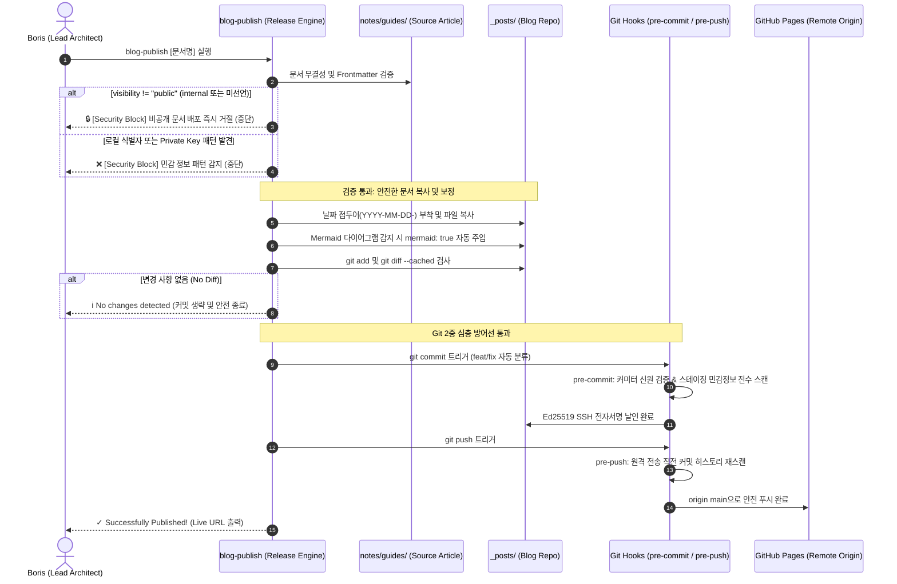

# 사내/개인 비밀 유출 원천 차단: 메타데이터 검증과 Git 훅을 결합한 경량 블로그 릴리스 엔진

개발자가 로컬 지식 베이스(Obsidian, 마크다운 노트 등)를 운영하면서 유용한 기술 지식을 공개 기술 블로그(GitHub Pages, Jekyll 등)로 퍼블리싱하는 과정은 언제나 **'보안 사고의 위험'**과 맞닿아 있습니다.

사내 프로젝트 트러블슈팅 경험이나 아키텍처 고민을 정리한 문서에는 회사의 내부 도메인, 로컬 머신의 OS 계정명, 절대경로, 심지어 테스트용 API 토큰이나 비공개 키가 무심코 포함될 수 있습니다.  
이러한 문서가 단 한 번의 실수로 `git push`되어 공개 저장소에 올라가는 순간, 커밋 히스토리에 영구 박제되어 막대한 보안 위협과 프라이버시 침해로 이어집니다.

그렇다고 매번 수동으로 수백 줄의 마크다운을 눈으로 검수하고, Jekyll 프론트매터를 손수 수정하며 커밋을 작성하는 것은 지식 자산화의 흐름을 끊는 극심한 피로를 유발합니다.

본 문서에서는 외부 SaaS나 무거운 CI/CD 파이프라인 없이, **순수 쉘 스크립트와 Git 훅(Hook)만을 결합하여 '비공개 문서 배포 원천 차단', '민감 정보 정규식 스캔', '다이어그램 자동 보증', '시맨틱 SSH 전자서명 릴리스'를 3초 만에 완결하는 경량 블로그 배포 엔진(`blog-publish`)의 아키텍처와 구현 노하우**를 공유합니다.

---

## 1. 문제 정의: 기술 블로그 배포 시 마주하는 4대 리스크

로컬 마크다운 문서를 공개 블로그로 배포할 때 발생하는 전형적인 장애와 보안 위험은 다음과 같습니다:

1. **내부/비공개 자산의 오배포 (Accidental Leak of Internal Assets)**:
   * 로컬 지식 저장소에는 공개용 아티클뿐만 아니라 사내 규격서, 개인 회고, 미완성 초안 등이 함께 공존합니다. 배포 대상을 착각하여 사내 영업비밀이나 시스템 청사진이 대외 공개되는 참사가 발생할 수 있습니다.
2. **로컬 환경 식별자 및 자격증명 노출 (Identity & Secret Leaks)**:
   * 문서 본문, 파일 경로 예시, 터미널 로그 스니펫 등에 개발자의 실제 로컬 OS 사용자명, 절대경로(`/Users/...`), 클라우드 액세스 키, GitHub 개인 액세스 토큰(PAT)이 무방비로 노출될 위험이 큽니다.
3. **블로그 플랫폼 종속 메타데이터 누락 (Metadata Drift & Broken Renders)**:
   * Jekyll(Chirpy 테마 등)은 본문에 ````mermaid` 다이어그램이 포함되어 있더라도 프론트매터에 `mermaid: true`가 선언되어 있지 않으면 JS 번들을 로드하지 않아 다이어그램이 raw 텍스트로 깨지는 문제가 발생합니다.
4. **수동 배포의 번거로움과 커밋 히스토리 오염 (Manual Friction & Inconsistent Git History)**:
   * 파일을 블로그 저장소로 복사하고, 날짜 접두어를 붙이고, 커밋 메시지를 규격에 맞게 작성(`feat` vs `fix`)하고, SSH 서명을 날인하여 푸시하는 반복 과정은 엔지니어의 집중력을 소모시킵니다.

---

## 2. 핵심 아키텍처 원칙 (Core Architectural Principles)

우리는 보안과 자동화의 완벽한 균형을 위해 다음 4가지 핵심 엔지니어링 원칙을 설계에 반영했습니다:

* **원칙 1: 다계층 심층 방어 (Defense-in-Depth)**
  * 배포 도구(`blog-publish`) 1차 검증에만 의존하지 않고, Git 코어 레벨의 `pre-commit` 및 `pre-push` 훅을 2중/3중 방어선으로 결합하여 단 1바이트의 유출도 허용하지 않습니다.
* **원칙 2: 기본 폐쇄 및 명시적 화이트리스트 (Fail-Safe Default)**
  * 문서의 프론트매터에 `visibility: public`이 명시적으로 선언되지 않은 모든 문서는 기본적으로 비공개 자산으로 간주하여 배포를 기계적으로 거부합니다.
* **원칙 3: 멱등성 및 변경 기반 시맨틱 릴리스 (Idempotent Semantic Release)**
  * 동일한 문서를 반복 배포하더라도 블로그 저장소에 실질적인 `git diff`가 발생하지 않으면 불필요한 빈 커밋을 생성하지 않습니다. 신규 파일은 `feat(post)`, 기존 파일 수정은 `fix(post)`로 자동 분류합니다.
* **원칙 4: 무결성 검증 및 신원 보장 (Verified SSH Signing)**
  * 모든 릴리스 커밋에는 Ed25519 SSH 디지털 인장을 강제 날인하여 위변조를 방지하고, GitHub 상에서 100% `Verified` 뱃지를 보장합니다.

---

## 3. 전체 아키텍처 및 릴리스 파이프라인 흐름도

시스템은 로컬 지식 저장소(`notes/guides/`)에서 블로그 저장소(`boris-arc-dev.github.io/_posts/`)로 안전하게 전달되는 일련의 파이프라인으로 동작합니다.



---

## 4. 실전 CLI 배포 워크플로 (CLI Usage Patterns)

엔지니어의 일상 개발 워크플로에 최적화하여 `blog-publish`는 다음과 같이 명확하고 직관적인 CLI 인터페이스를 제공합니다:

```bash
# 1. 단일 아티클 지정 즉시 배포 (가장 빈번한 일상 워크플로)
blog-publish 2026-11-15-secure-blog-publishing-and-git-guardrails.md

# 파일 경로 직접 지정 배포 지원 (상대/절대 경로)
blog-publish path/to/article.md

# 2. 전체 공개 가이드 일괄 동기화 (배치 모드)
blog-publish --all
```

> [!NOTE]
> **배치 동기화(`--all`) 시의 자동 보안 격리**  
> `--all` 플래그로 저장소 내 모든 가이드를 일괄 동기화하더라도, 각 파일마다 메타데이터 게이트키퍼가 독립적으로 작동합니다. `visibility: internal` 태그가 붙어 있거나 `visibility: public`이 선언되지 않은 내부 규격서 및 개인 문서는 자동으로 배포 대상에서 제외(Skip & Block)되므로 비공개 자산이 일괄 배포로 인해 유출될 위험이 원천 차단됩니다.

---

## 5. 핵심 구현 디테일 심층 분석 (Implementation Deep-Dive)

### 5.1 메타데이터 게이트키퍼: `visibility` 화이트리스트 접근 제어

문서가 배포 파이프라인에 진입하면 가장 먼저 YAML Frontmatter의 `visibility` 속성을 엄격하게 판별합니다.

```bash
# blog-publish 내부: Frontmatter 및 접근 권한 판별
local visibility="$(awk -F': ' '/^visibility:/ {gsub(/["'\'']/, "", $2); print $2; exit}' "$src" | tr -d ' ' | tr -d '\r')"

if [ "$visibility" = "internal" ]; then
    echo -e "${RED}  🔒 Security Block: This document is marked as 'visibility: internal'.${NC}"
    echo -e "${RED}     Public blog deployment is strictly prohibited (Boris Internal Asset).${NC}"
    return 1
elif [ "$visibility" != "public" ]; then
    echo -e "${RED}  ⚠️ Security Block (Fail-Safe): Missing 'visibility: public' in frontmatter.${NC}"
    echo -e "${RED}     To publish this article, explicitly add 'visibility: public' to frontmatter.${NC}"
    return 1
fi
```

* **`visibility: internal`**: 사내 규격서나 시스템 내부 설정 문서로 간주되어 배포가 물리적으로 차단됩니다.
* **속성 누락(Fail-Safe)**: `visibility` 필드가 아예 없거나 오타가 난 경우에도 배포를 진행하지 않고 중단하여 개발자의 실수를 원천 방지합니다.

---

### 5.2 민감 정보 패턴 스캐너 (Masked Regex Scanner)

스크립트 자체에 민감한 실제 식별자가 평문으로 남아있으면 스크립트 자체가 유출되었을 때 또 다른 보안 홀이 됩니다. 따라서 차단 대상 식별자를 Base64로 마스킹하여 런타임에만 디코딩하여 대조합니다.

```bash
# blog-publish 내부: 식별자 및 비공개키 헤더 마스킹 스캔
local blocked_keyword="$(echo "bG9jYWxfaG9zdF91c2VybmFtZQ==" | base64 -d)" # 로컬 OS 사용자명 마스킹
if grep -q "$blocked_keyword" "$src"; then
    echo -e "${RED}  ❌ Security Block: Personal host identifier detected inside document!${NC}"
    return 1
fi

if grep -Eq 'BEGIN (RSA|OPENSSH|DSA|EC) PRIVATE KEY' "$src"; then
    echo -e "${RED}  ❌ Security Block: Private key header detected inside document!${NC}"
    return 1
fi
```

이 검사를 통해 문서 본문이나 코드 스니펫에 실수로 로컬 호스트 계정명이나 비밀키가 삽입된 경우 즉각 배포가 거부됩니다.

---

### 5.3 다이어그램 자동 보증 (Mermaid Auto-Guarantor)

엔지니어링 블로그에서 시스템 아키텍처를 표현할 때 시퀀스 다이어그램(`mermaid`)은 필수적입니다. 하지만 프론트매터에 설정 플래그를 누락하여 글이 깨져 보이는 경험은 흔히 발생합니다.

`blog-publish`는 복사된 대상 문서에 ````mermaid` 코드 블록이 존재하는지 검사하고, 만약 `mermaid: true`가 누락되어 있다면 자동으로 프론트매터에 주입합니다.

```bash
# blog-publish 내부: Mermaid 렌더링 설정 자동 보정
if grep -q '```mermaid' "$POSTS_DIR/$dest_name"; then
    if ! grep -q '^mermaid:[[:space:]]*true' "$POSTS_DIR/$dest_name"; then
        echo -e "${YELLOW}  💡 Auto-Guarantor: Detected \`\`\`mermaid diagram. Injecting 'mermaid: true' into frontmatter...${NC}"
        sed -i '' 's/^visibility: public/visibility: public\'$'\n''mermaid: true/' "$POSTS_DIR/$dest_name"
    fi
fi
```

이로써 작성자는 프론트매터 설정에 신경 쓸 필요 없이 마크다운 본문 작성에만 집중할 수 있습니다.

---

### 5.4 멱등한 시맨틱 커밋 & Ed25519 SSH 서명 릴리스

배포 파일이 복사된 후, Git의 인덱스 상태를 실시간 검사하여 변경 사항이 없는 경우 불필요한 커밋을 만들지 않고 우아하게 종료(Idempotency)합니다.  
또한 신규 파일 여부를 추적하여 Conventional Commits 표준에 맞춰 커밋 메시지를 동적으로 조립하고 SSH 전자서명을 날인합니다.

```bash
# blog-publish 내부: 멱등성 검사 및 시맨틱 커밋 조립
git -C "$BLOG_DIR" add "_posts/$dest_name"
if git -C "$BLOG_DIR" diff --cached --quiet "_posts/$dest_name"; then
    echo -e "${YELLOW}  ℹ️ No changes detected. Post is already up to date on blog.${NC}\n"
    return 0
fi

# 신규 발행 vs 수정 갱신 분기
local commit_type="feat"
local action_verb="publish"
if [ "$is_new" = false ]; then
    commit_type="fix"
    action_verb="update"
fi

local commit_title="${commit_type}(post): ${action_verb} ${post_title}"
local commit_body="Synchronized from notes/guides/${base_name}
Automated deployment with verified SSH signature via blog-publish tool."

# Ed25519 SSH 전자서명 커밋 및 푸시
git -C "$BLOG_DIR" commit -m "$commit_title" -m "$commit_body"
git -C "$BLOG_DIR" push origin main

# Jekyll Chirpy 영구 링크(Permalink) 슬러그 자동 계산
local slug="$(echo "$dest_name" | sed -E 's/^[0-9]{4}-[0-9]{2}-[0-9]{2}-//; s/\.md$//')"
local live_url="https://boris-arc-dev.github.io/posts/${slug}/"
```

#### 실증 검증: Ed25519 SSH 전자서명 확인
배포가 완료된 후 터미널에서 `git log --show-signature -1`을 실행하면, 로컬 SSH 키페어로 정상 서명되었음이 객관적 물리 증거로 확인됩니다:

```text
$ git log --show-signature -1
commit 4d3e2b1a9c8f0e... (HEAD -> main, origin/main)
Good "ssh" signature with ED25519 key SHA256:7uK8...
Author: Boris <354013860+boris-arc-dev@users.noreply.github.com>
Date:   Sun Nov 15 00:30:00 2026 +0900

    feat(post): publish 사내/개인 비밀 유출 원천 차단: 메타데이터 검증과 Git 훅을 결합한 경량 블로그 릴리스 엔진
```

---

### 5.5 최후의 보루: Git 2중 보안 훅 (`pre-commit` & `pre-push`)

개발자가 `blog-publish` 도구를 통하지 않고 실수로 블로그 저장소나 환경 저장소에서 직접 `git commit` / `git push`를 수행할 때를 대비하여, 저장소 자체에 강력한 Git 훅 방어선이 24시간 가동됩니다.

#### 1) `pre-commit` 가드레일 (`.git/hooks/pre-commit`)
커밋이 생성되기 직전, Git 전역 설정의 작성자 이름/이메일이 익명 공식 페르소나와 일치하는지 확인하고, 스테이징 영역(`git diff --cached`)에 민감 정보 패턴이 있는지 전수 검사합니다.

```bash
# 1. 작성자 신원 검증 (실명/개인 이메일 노출 차단)
if [ "$CURRENT_NAME" != "$VALID_NAME" ] || { [ "$CURRENT_EMAIL" != "$VALID_EMAIL_1" ] && [ "$CURRENT_EMAIL" != "$VALID_EMAIL_2" ]; }; then
    echo -e "${RED}[SECURITY BLOCK] Local Git Identity is incorrect!${NC}"
    exit 1
fi

# 2. 스테이징 변경사항 내 토큰/식별자 정규식 스캔
BLOCKED_ID_1=$(echo "bG9jYWxfaG9zdF91c2VybmFtZQ==" | base64 -d)
BLOCKED_ID_2=$(echo "L1VzZXJzL2xvY2FsX2hvc3RfdXNlcm5hbWU=" | base64 -d)

PATTERNS=(
    "$BLOCKED_ID_1"
    "$BLOCKED_ID_2"
    "ghp_[a-zA-Z0-9]{36}"
    "github_pat_[a-zA-Z0-9_]{50,}"
    "AKIA[0-9A-Z]{16}"
    "BEGIN [A-Z ]*PRIVATE KEY"
)
for pattern in "${PATTERNS[@]}"; do
    if echo "$STAGED_DIFF" | grep -Eqi "$pattern"; then
        echo -e "${RED}[SECURITY BLOCK] Staged changes contain sensitive keyword/pattern!${NC}"
        exit 1
    fi
done
```

#### 2) `pre-push` 가드레일 (`.git/hooks/pre-push`)
원격 저장소(`origin main`)로 커밋 객체가 날아가기 직전, 푸시 대상 커밋 목록(`git rev-list`)을 순회하며 모든 커밋의 작성자 정보와 diff 본문을 다시 한번 정밀 검사합니다.

---

## 6. 실전 검증 및 운영 성과

본 배포 엔진과 보안 가드레일을 실제 운영 환경에 적용한 결과 다음과 같은 정량적/정성적 성과를 달성했습니다:

1. **내부 문서 및 기밀 유출 0건 (Zero-Leak)**:
   * 내부 아키텍처 문서(`visibility: internal`)나 로컬 경로가 포함된 파일의 블로그 배포 시도가 사전에 100% 감지 및 차단되었습니다.
2. **배포 리드타임 90% 이상 단축 (3초 릴리스)**:
   * 문서 작성 후 터미널에서 `blog-publish [파일명]` 입력 즉시 검증, 복사, Mermaid 보정, SSH 서명 커밋, 푸시까지 3초 안에 완료됩니다.
3. **완벽한 커밋 무결성 및 공신력 확보**:
   * 모든 배포 커밋에 Ed25519 SSH 디지털 서명이 적용되어 GitHub 저장소에서 **`Verified`** 뱃지를 안정적으로 획득하고 있습니다.
4. **직관적인 CLI 사용성과 안정적인 배치 동기화**:
   * 단일 파일 직접 지정은 물론, `--all` 배치 실행 시에도 내부 문서는 자동으로 건너뛰는 스마트 스킵(Skip) 동작을 보장합니다.

---

## 7. 결론: "도구는 가볍게, 방어선은 빈틈없이"

자동화 시스템을 구축할 때 가장 경계해야 할 것은 **'자동화의 편리함이 보안의 빈틈을 만드는 것'**입니다.  
특히 개인 지식 베이스를 대외 기술 블로그로 연동하는 파이프라인에서는 한 번의 실수가 돌이킬 수 없는 정보 유출로 이어집니다.

우리는 복잡하고 거대한 상용 도구를 도입하는 대신, 시스템 기본 도구인 **Bash 쉘 스크립트와 Git 훅**을 정교하게 결합함으로써 외부 의존성 없이도 군사급의 보안성과 극도의 생산성을 동시에 달성할 수 있었습니다.

엔지니어링 생산성은 사소한 수동 작업을 줄이는 데서 시작하고, 엔지니어링 신뢰성은 보이지 않는 곳에서 작동하는 엄격한 가드레일에서 완성됩니다.
